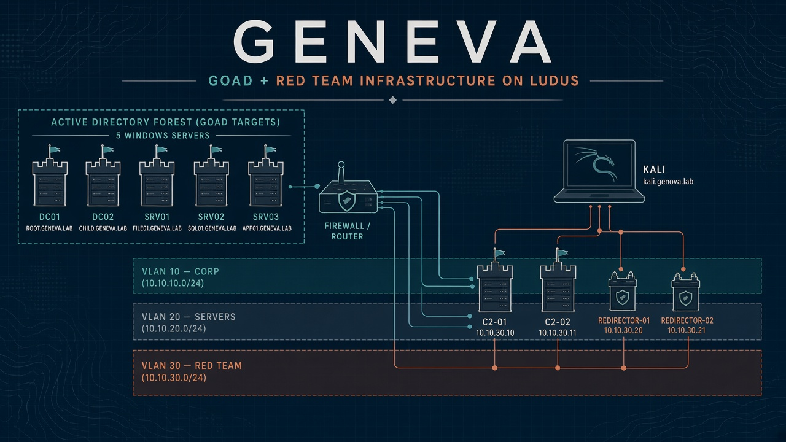
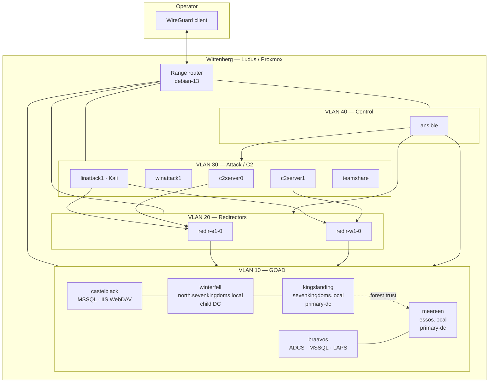
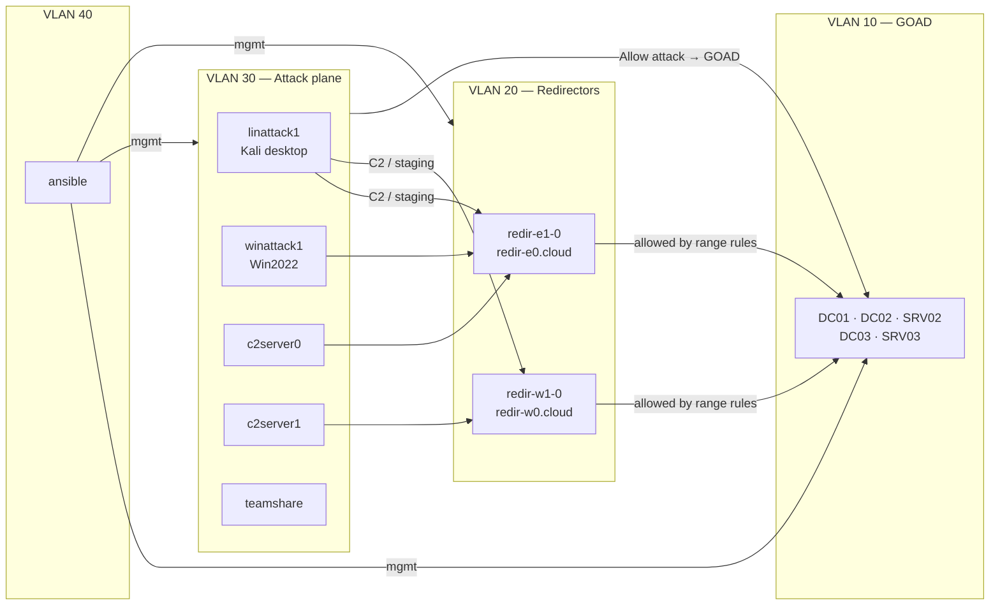

<p align="center">
  
</p>

# Geneva

**GOAD Active Directory lab + red-team attack infrastructure**, deployed as one [Ludus](https://docs.ludus.cloud/) range on a Debian/Proxmox host named **Wittenberg**.

Defender stays **enabled** on the Windows targets. Traffic between the attack stack and GOAD is constrained by explicit inter-VLAN rules (redirectors in the middle).

---

## What this is

| Layer | VLAN | Role |
| --- | --- | --- |
| **GOAD targets** | 10 | Game of Active Directory forests / domains / member servers |
| **Redirectors** | 20 | Edge redirectors (`redir-e1-0`, `redir-w1-0`) |
| **Attack / C2** | 30 | Kali, Windows attack box, C2 servers, teamshare |
| **Ansible** | 40 | Control node for post-deploy playbooks |
| **Ludus router** | — | Debian 13 template cloned automatically by Ludus |

Based on [Orange-Cyberdefense/GOAD](https://github.com/Orange-Cyberdefense/GOAD) and the Ludus GOAD blueprint from [badsectorlabs/ludus-source-bsl](https://github.com/badsectorlabs/ludus-source-bsl) (`blueprints/goad`), plus a purpose-built red-team VLAN layout.

### GOAD references

- [GOAD (Orange Cyberdefense)](https://github.com/Orange-Cyberdefense/GOAD) — original lab design & attack paths  
- [GOAD documentation](https://orange-cyberdefense.github.io/GOAD/)  
- [Ludus GOAD blueprint](https://github.com/badsectorlabs/ludus-source-bsl/tree/main/blueprints/goad)  
- [ludus_windows_utils](https://github.com/badsectorlabs/ludus_windows_utils) · [ludus_adcs](https://github.com/badsectorlabs/ludus_adcs) · [ludus_mssql](https://github.com/badsectorlabs/ludus_mssql)  
- [Ludus docs](https://docs.ludus.cloud/) · [Proxmox install](https://docs.ludus.cloud/docs/deployment-options/proxmox) · [Testing mode](https://docs.ludus.cloud/docs/quick-start/deploy-range/)

---

## Architecture

### Full range



### Red-team infrastructure (detail)



### GOAD domains

| Host | IP (last octet) | Domain | Notes |
| --- | --- | --- | --- |
| `kingslanding` | `.10.10` | `sevenkingdoms.local` | Forest root DC |
| `winterfell` | `.10.11` | `north.sevenkingdoms.local` | Child domain DC |
| `castelblack` | `.10.12` | north member | MSSQL ↔ linked to braavos |
| `meereen` | `.10.13` | `essos.local` | Separate forest + trust |
| `braavos` | `.10.14` | essos member | ADCS (ESC1–16), MSSQL, LAPS, gMSA |

---

## Repository layout

| Path | Purpose |
| --- | --- |
| `range.yml` | Full Ludus range: GOAD + red infra + VLAN rules |
| `setup-wittenberg.sh` | Host bootstrap: `--install` / `--users` / `--templates` / `--deploy` / `--fix-debian13` |
| `inventory.yml` | Ansible inventory (`RANGE_ID` / `RANGE_NUMBER` stamped on deploy) |
| `requirements.yml` | Ludus Ansible collection + roles for GOAD |
| `deploy-range.yml` / `deploy-lin.yml` | Optional post-deploy playbooks (e.g. Kali SSH key) |
| `files/lin_key.pub` | Drop your operator pubkey here before `deploy-lin.yml` |
| `docs/assets/` | README banner |

---

## Quick start

```bash
su -
cd /opt/ranges          # clone this repo here
chmod +x setup-wittenberg.sh

# 1) Install Ludus (node name: wittenberg when prompted)
./setup-wittenberg.sh --install
# reboot if asked, then:
ludus-install-status
export LUDUS_API_KEY='YOURUSER.…'   # not ROOT

# 2) Optional extra Ludus user
./setup-wittenberg.sh --users

# 3) Templates — Enter builds: debian-13 (router) + win2022 + ubuntu-22.04 + kali
./setup-wittenberg.sh --templates
ludus templates logs -f
ludus templates list

# If debian-13 Packer dies in ~2s (ISO 404 under current/):
./setup-wittenberg.sh --fix-debian13
ludus templates build -n debian-13-x64-server-template

# 4) Deploy (installs GOAD roles for your API-key user, then config + deploy)
./setup-wittenberg.sh --deploy
ludus range logs -f
```

### Required templates (BUILT)

- `debian-13-x64-server-template` — Ludus range router (not listed in `range.yml`)
- `win2022-server-x64-template`
- `ubuntu-22.04-x64-server-template`
- `kali-x64-desktop-template`

`--deploy` installs:

```bash
ludus ansible collection add badsectorlabs.ludus_windows_utils
ludus ansible role add badsectorlabs.ludus_adcs
ludus ansible role add badsectorlabs.ludus_mssql
```

---

## Day-2 operations

### WireGuard

```bash
ludus user wireguard | tee ~/geneva-wireguard.conf
# import on your workstation, connect, then reach 10.<range>.0.0/16
```

### Testing mode (cut internet)

```bash
ludus testing start          # snapshot + block outbound / DNS
ludus testing status
ludus testing allow --domain example.com
ludus testing stop           # revert snapshots + restore internet
```

Per-VM exceptions use `testing.block_internet` in `range.yml`  
(`true` = blocked in testing, `false` = keep internet).

### Optional Kali SSH key

```bash
# put your pubkey in files/lin_key.pub, stamp inventory, then:
ansible-playbook -i inventory.yml deploy-lin.yml
```

---

## Network policy (summary)

`network.inter_vlan_default: REJECT` with explicit ACCEPT rules for:

- Ansible (40) → attack (30), redirectors (20), GOAD (10)
- Attack (30) ↔ redirectors (20)
- Attack (30) → GOAD (10)
- GOAD (10) → redirectors (20)

`external_default: ACCEPT` until you enter testing mode or change the default.

---

## Disclaimer

Lab credentials follow GOAD / Ludus defaults (`domainadmin` / `password`, `kali` / `kali`, etc.). **Do not expose this range to the public internet.** For authorized training and research only.
